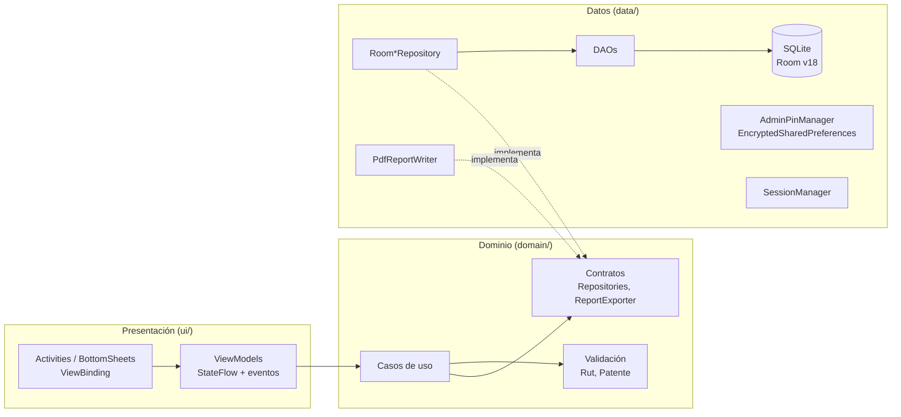
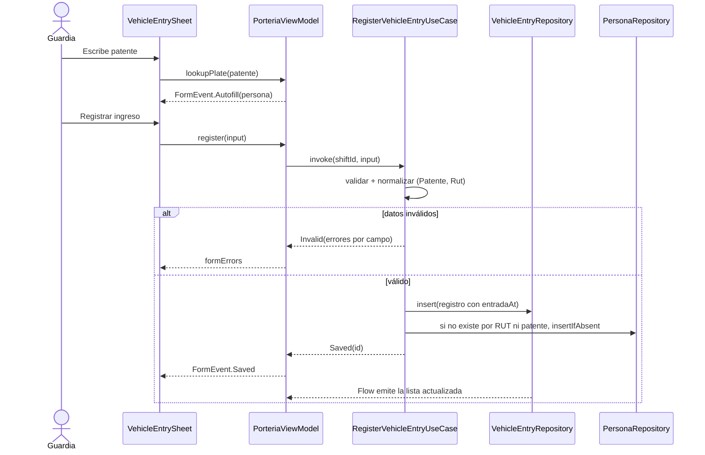
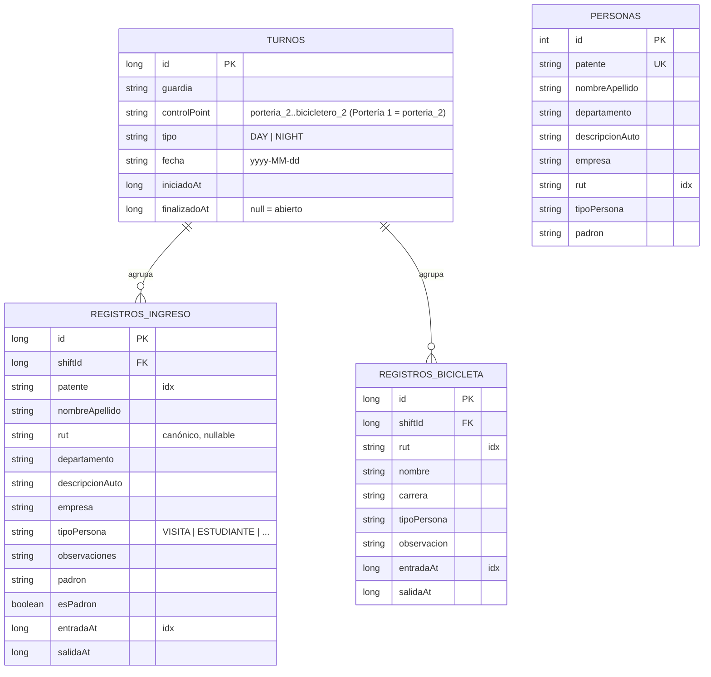

# Controlate Android

[](https://github.com/dur1al/controlate-android/actions/workflows/android.yml)

-3DDC84?logo=android&logoColor=white)


Aplicación Android nativa **offline-first** para el control de accesos vehiculares y bicicleteros en porterías: registro de ingresos y salidas por turno, directorio con autocompletado y reportes PDF.

Está pensada para un guardia en garita, con el teléfono en una mano, poca luz y fila de autos: pocas pantallas, una acción principal por pantalla, autocompletado desde el directorio y cero dependencia de la red.

---

## Contenido

- [Funcionalidades](#funcionalidades)
- [Arquitectura](#arquitectura)
- [Modelo de datos](#modelo-de-datos)
- [Decisiones técnicas](#decisiones-técnicas)
- [Seguridad y privacidad](#seguridad-y-privacidad)
- [Calidad y pruebas](#calidad-y-pruebas)
- [Cómo ejecutar](#cómo-ejecutar)
- [Estructura del proyecto](#estructura-del-proyecto)
- [Limitaciones conocidas y roadmap](#limitaciones-conocidas-y-roadmap)

---

## Funcionalidades

| Módulo | Qué permite |
| :--- | :--- |
| **Turnos** | El guardia inicia turno (nombre, día/noche, punto de control). Si la app se cierra, retoma el turno abierto. Al cerrarlo, el reporte PDF queda guardado para administración. |
| **Portería vehicular** | Registro de ingreso con validación de patente y RUT (módulo 11), autocompletado por patente o RUT desde el directorio, búsqueda en el turno y salida con un toque y opción **Deshacer**. |
| **Bicicletero** | Ingreso por RUT con autocompletado (último registro o directorio), búsqueda por RUT o nombre, salida con **Deshacer** y exportación PDF del turno. |
| **Panel administrador** | Protegido por PIN. Muestra entradas, salidas y personas dentro del día por punto de control. Incluye resumen PDF, listado de turnos con filtro por fecha y exportación o borrado, y limpieza de datos operativos. |
| **Directorio** | Búsqueda, edición y eliminación de personas, importación masiva CSV (todo o nada, con errores por línea) y exportación PDF. |

Todo funciona sin conexión. Los reportes se comparten con el selector nativo de Android (`FileProvider`).

---

## Arquitectura

Clean Architecture en tres capas dentro de un único módulo, con MVVM en la presentación e inyección de dependencias con Koin. La dirección de dependencias apunta al dominio: la UI conoce el dominio, el dominio define contratos (`domain/repository`) y la capa de datos los implementa con Room.



**Patrones aplicados**

- **Unidirectional Data Flow:** cada ViewModel expone un `StateFlow<UiState>` inmutable y un canal de eventos de una sola vez (navegación, snackbars). La vista solo renderiza el estado y envía intenciones.
- **Repository + puertos:** los casos de uso dependen de interfaces, así se prueban con fakes en memoria sin Android.
- **Use cases:** reglas de negocio (validar, normalizar, registrar, cerrar turno, armar reportes) aisladas de la UI.
- **Inyección de dependencias:** `dataModule`, `domainModule` y `presentationModule` en Koin; un test verifica que todo el grafo resuelve.
- **Reloj inyectable (`Clock`):** toda lógica temporal es determinista en tests.

Flujo de registro de un ingreso vehicular:



El detalle de capas, decisiones (ADRs) y la estrategia de migración está en [docs/ARCHITECTURE.md](docs/ARCHITECTURE.md).

---

## Modelo de datos

Base Room versión 18. Los instantes se guardan como **epoch millis**; fecha y hora visibles se derivan al mostrar. `turnos` es la raíz de agregación: cada registro pertenece a un turno (FK con `ON DELETE CASCADE`).



`personas` no tiene relación con los turnos: el directorio se vincula a los registros por valor (patente/RUT) solo para autocompletar. El esquema exportado vive en [`app/schemas/`](app/schemas/).

---

## Decisiones técnicas

| Tecnología | Uso | Motivo |
| :--- | :--- | :--- |
| **Room 2.6 + KSP** | Persistencia local, `Flow` reactivo | Consultas verificadas en compilación, migraciones explícitas y esquema exportado y testeado. |
| **Koin 3.5** | DI | DSL en Kotlin puro sin generación de código; el grafo se valida con un test. |
| **Coroutines + StateFlow** | Concurrencia y estado de UI | Cancelación estructurada con `viewModelScope` y recolección consciente del ciclo de vida (`repeatOnLifecycle`). |
| **java.time** | Fechas y horas | Inmutable y thread-safe, a diferencia de `SimpleDateFormat`. Disponible desde la API 26. |
| **android.graphics.pdf** | Reportes PDF | Sin dependencias externas; el contenido (`ReportDocument`) se arma en el dominio y se dibuja en `data/report`. |
| **EncryptedSharedPreferences** | Hash del PIN admin | Cifrado AES-256 con llave en Android Keystore. |
| **Robolectric + room-testing** | Tests de DAOs y migraciones en la JVM | Verifican SQL real sin emulador, también en CI. |

---

## Seguridad y privacidad

- **Sin credenciales por defecto.** El PIN de administrador se define en el primer acceso y se guarda como hash `PBKDF2WithHmacSHA256` (100 000 iteraciones y salt de 16 bytes), cifrado en `EncryptedSharedPreferences`. La comparación es en tiempo constante. Tras 5 intentos fallidos el acceso se bloquea 30 s. La derivación corre fuera del hilo principal.
- **Datos fuera de los respaldos.** `allowBackup="false"` más reglas explícitas que excluyen la base (incluidos `-wal`/`-shm`), las preferencias y la carpeta `reports/` tanto del respaldo en la nube como de la transferencia entre dispositivos (Android 12+).
- **Mínimo privilegio al compartir.** `FileProvider` expone solo `files/reports/`.
- **Entradas validadas y SQL parametrizado.** El RUT se valida con módulo 11 y la patente con su formato. Las búsquedas usan `instr()`, así que `%` y `_` no actúan como comodines.
- **Sin logs de datos personales.** El código de producción no escribe en Logcat.
- **Datos semilla 100 % sintéticos** (`res/raw/`).
- **Release minificado** con R8 (`isMinifyEnabled` + `isShrinkResources`).

Política completa y reporte de vulnerabilidades en [SECURITY.md](SECURITY.md).

---

## Calidad y pruebas

```bash
./gradlew testDebugUnitTest   # dominio, ViewModels, Room (Robolectric), migración y grafo DI
./gradlew lintDebug           # abortOnError = true
./gradlew assembleDebug
```

| Capa | Qué se prueba |
| :--- | :--- |
| Dominio | Validación de RUT y patente, parser CSV, casos de uso de turno, ingreso, salida, estadísticas y reportes (con fakes y reloj controlado). |
| Datos | DAOs sobre SQLite real: agregados por punto, cascada de borrado, FK, búsqueda literal, salidas idempotentes, carga semilla idempotente. Migración 17→18 con datos heredados, incluido un turno nocturno que cruza medianoche. |
| Seguridad | Hash de PIN, bloqueo por intentos, cambio de PIN. |
| Presentación | ViewModels: estados, errores de formulario, deshacer salida, cierre de turno con y sin fallo del reporte. |
| DI | Todo ViewModel se resuelve desde el grafo Koin. |

GitHub Actions ejecuta tests, lint y build en cada push o PR a `main`, valida el Gradle wrapper y publica los reportes como artefacto. Dependabot propone actualizaciones semanales.

---

## Cómo ejecutar

**Requisitos:** Android Studio (Koala o superior) y JDK 17. El proyecto usa `compileSdk 36` y `minSdk 26`.

```bash
git clone https://github.com/dur1al/controlate-android.git
cd controlate-android
./gradlew assembleDebug
```

1. Abre el proyecto en Android Studio y ejecútalo en un emulador o dispositivo.
2. En la primera ejecución se carga un directorio demo sintético.
3. Inicia un turno con cualquier nombre. Para ver el panel, pulsa **Vista Admin** y define un PIN de 4 a 8 dígitos.

---

## Estructura del proyecto

```text
app/src/main/java/com/dur1al/controlate/
├── App.kt                         # Koin + carga semilla en segundo plano
└── porteria/
    ├── di/                        # dataModule, domainModule, presentationModule
    ├── domain/
    │   ├── model/                 # ControlPoint, PersonaType, ShiftType, entradas, errores de validación
    │   ├── validation/            # Rut, Patente
    │   ├── usecase/               # Turnos, ingresos, salidas, estadísticas, reportes
    │   ├── repository/            # Contratos de persistencia
    │   ├── report/                # ReportDocument, ReportExporter
    │   ├── importer/              # PersonaCsvParser
    │   └── time/                  # TimeFormat, Clock
    ├── data/
    │   ├── local/                 # Room (entities, dao, database, migraciones, seeder), sesión, seguridad
    │   ├── repository/            # Implementaciones Room
    │   └── report/                # PdfReportWriter, ReportStore
    └── ui/                        # login, porteria, bicicletero, admin, db, settings, common
```

---

## Limitaciones conocidas y roadmap

- **Un dispositivo por punto de control:** no hay sincronización entre equipos ni respaldo remoto (decisión offline-first).
- **Base sin cifrar en reposo:** protegida por el sandbox de Android; evaluar SQLCipher si el contexto lo exige.
- **Versiones de dependencias:** Kotlin 1.9 y AndroidX de 2024. Su actualización (Kotlin 2.x, Room 2.7+) queda delegada a Dependabot con PRs separados. Además, `security-crypto` figura como deprecado en las versiones recientes de AndroidX y conviene planificar su reemplazo (Keystore + Tink).
- **Próximos pasos:** desbloqueo biométrico para el admin, lectura OCR de patentes con ML Kit y migración incremental a Jetpack Compose.

---

Proyecto personal de portafolio. Los datos incluidos son ficticios.
