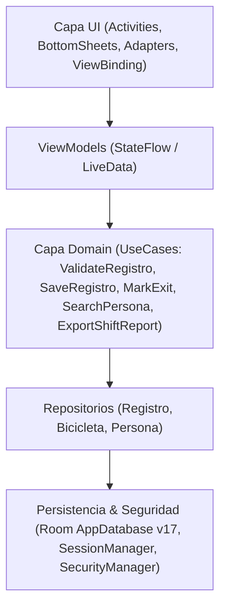
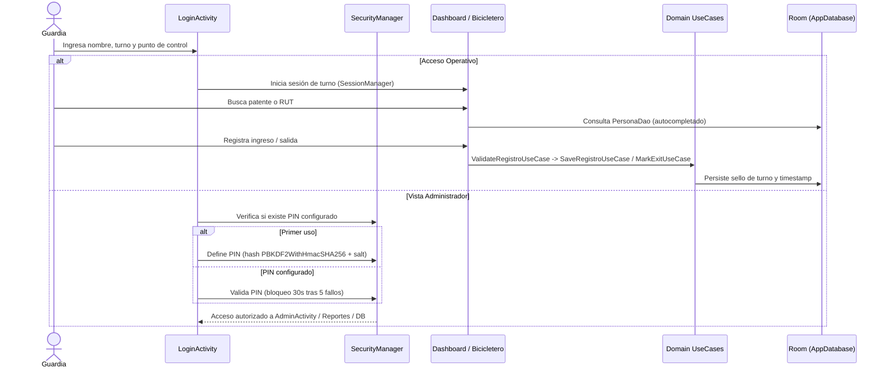
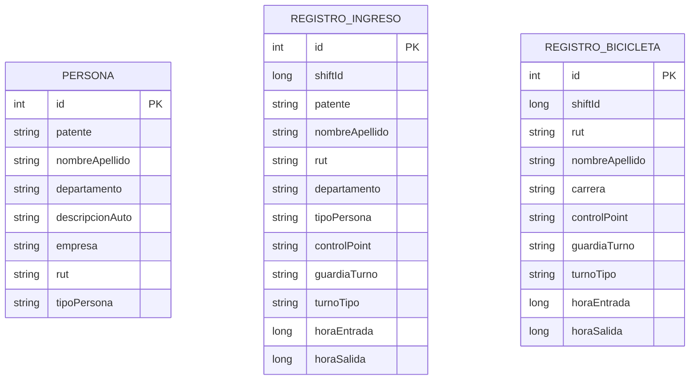

# Controlate Android


-3DDC84?logo=android&logoColor=white)


Aplicación Android nativa **offline-first** para el control operativo de accesos vehiculares, gestión de bicicleteros y trazabilidad de turnos en porterías.

Diseñada para operar de forma continua en garitas y puntos de control con conectividad nula o intermitente, priorizando velocidad de registro, integridad de auditoría y privacidad de datos en el dispositivo.

---

## Tabla de Contenidos

- [Problema y Propuesta de Valor](#problema-y-propuesta-de-valor)
- [Arquitectura del Sistema](#arquitectura-del-sistema)
- [Flujo Operativo y de Seguridad](#flujo-operativo-y-de-seguridad)
- [Modelo de Datos (Room v17)](#modelo-de-datos-room-v17)
- [Decisiones Técnicas](#decisiones-técnicas)
- [Seguridad y Privacidad](#seguridad-y-privacidad)
- [Inicio Rápido y Modo Demo](#inicio-rápido-y-modo-demo)
- [Pruebas y Calidad](#pruebas-y-calidad)
- [Diagramas de Referencia](#diagramas-de-referencia)
- [Roadmap Técnico](#roadmap-técnico)

---

## Problema y Propuesta de Valor

En puntos de control físicos (porterías, estacionamientos, bicicleteros), las planillas en papel o sistemas web dependientes de red fallan cuando cae la señal o aumentan los flujos en hora punta. **Controlate Android** resuelve esto con:

- **Operación Offline-First Real:** Persistencia íntegra en SQLite local (Room) con migraciones explícitas y autocompletado instantáneo desde directorio local.
- **Trazabilidad por Turno:** Cada ingreso y salida queda sellado con el guardia activo, tipo de turno (`DÍA` / `NOCHE`), `shiftId` y punto de control (`ControlPoint`).
- **Identidad Visual Dinámica:** Cada punto de control aplica su propia paleta cromática para reducir errores de registro en cambios de garita.
- **Exportación Autónoma:** Generación local de reportes de turno y resúmenes administrativos en PDF y Excel (`.xlsx`) mediante `FileProvider`.

---

## Arquitectura del Sistema

La aplicación sigue **Clean Architecture + MVVM** con inyección de dependencias mediante **Koin** (`AppModule`):



### Estructura de Paquetes

```text
app/src/main/java/com/dur1al/controlate/
├── App.kt                          # Inicialización de Koin y WorkManager
├── MainActivity.kt                 # Dashboard principal de portería vehicular
└── porteria/
    ├── data/
    │   ├── ControlPoint.kt         # Puntos de control e identidad visual
    │   ├── local/
    │   │   ├── dao/                # RegistroDao, BicicletaDao, PersonaDao
    │   │   ├── database/           # AppDatabase (Room v17 + SeedCallback)
    │   │   ├── entities/           # Entidades SQLite
    │   │   ├── security/           # SecurityManager + PinSecurityHelper (PBKDF2)
    │   │   └── session/            # SessionManager (SharedPreferences de turno)
    │   └── repository/             # Repositorios desacoplados
    ├── di/
    │   └── AppModule.kt            # Grafo de dependencias Koin
    ├── domain/
    │   ├── model/                  # PersonaType, ShiftType, ShiftInfo, Result
    │   ├── usecase/                # Casos de uso de negocio (ingresos, salidas, reportes)
    │   └── util/                   # DateFormatter
    ├── ui/                         # Pantallas MVVM (login, dashboard, bicicletero, admin, db, directory, history, settings)
    └── utils/                      # ReportManager, RutUtils, SyncManager, PointDisplayHelper
```

---

## Flujo Operativo y de Seguridad



---

## Modelo de Datos (Room v17)



---

## Decisiones Técnicas

| Tecnología | Uso en el proyecto | Por qué se eligió |
| :--- | :--- | :--- |
| **Room + KSP** | Base de datos SQLite local (`v17`) | Seguridad en tiempo de compilación para queries SQL, migraciones explícitas y soporte reactivo con `Flow`. |
| **Koin** | Inyección de dependencias | Configuración declarativa en Kotlin puro sin generación pesada de código ni boilerplate excesivo en proyectos medianos. |
| **EncryptedSharedPreferences** | Almacenamiento de hash de PIN | Cifrado `AES256_SIV` / `AES256_GCM` respaldado por Android Keystore. |
| **PBKDF2WithHmacSHA256** | Derivación de PIN administrativo | Salt aleatorio de 16 bytes + 100.000 iteraciones y comparación en tiempo constante (`MessageDigest.isEqual`). |
| **Coroutines & StateFlow** | Concurrencia y estado UI | Cancelación estructurada vinculada a `viewModelScope` y actualización reactiva de métricas. |
| **Apache POI + PdfDocument** | Exportación de reportes | Generación de reportes `.xlsx` y PDF directamente en dispositivo sin depender de servidores externos. |
| **WorkManager** | Tareas diferidas | Base preparada para sincronización resiliente cuando exista conectividad (`SyncManager`). |

Para el detalle completo de decisiones arquitectónicas (ADRs), revisa [docs/ARCHITECTURE.md](docs/ARCHITECTURE.md).

---

## Seguridad y Privacidad

- **Cero secretos en el código:** No existen PINs por defecto hardcodeados; el PIN administrativo se configura en el primer ingreso.
- **Datos 100% sintéticos:** El archivo `res/raw/seed_personas.json` contiene únicamente registros ficticios de demostración.
- **Sin backups automáticos en la nube:** `android:allowBackup="false"` más reglas explícitas en `backup_rules.xml` y `data_extraction_rules.xml` protegen `controlate_secure_prefs.xml`, `porteria_prefs.xml` y `porteria_db`.
- **Minificación en Release:** `isMinifyEnabled = true` y `isShrinkResources = true` con reglas ProGuard/R8 configuradas.

Consulta la política completa en [SECURITY.md](SECURITY.md).

---

## Inicio Rápido y Modo Demo

### Requisitos
- **Android Studio** Koala o superior
- **JDK 17**
- **Android SDK:** `minSdk = 26` (Android 8.0), `compileSdk = 36`

### Compilación y Ejecución
```bash
git clone https://github.com/dur1al/controlate-android.git
cd controlate-android
./gradlew assembleDebug
```

1. Abre el proyecto en **Android Studio** y sincroniza Gradle.
2. Ejecuta la app en un emulador o dispositivo físico (`minSdk 26`).
3. En la primera ejecución, Room precarga automáticamente el directorio demo (`seed_personas.json`).
4. Al pulsar **Vista Admin** por primera vez, la app solicitará definir un **PIN numérico de 4 a 8 dígitos**.

---

## Pruebas y Calidad

```bash
# Tests unitarios JVM (lógica de negocio, validadores, hashing PBKDF2, RUT)
./gradlew testDebugUnitTest --console=plain

# Análisis estático Android Lint
./gradlew lintDebug --console=plain

# Compilación Debug
./gradlew assembleDebug --console=plain
```

El flujo de CI en GitHub Actions (`.github/workflows/android.yml`) ejecuta automáticamente `testDebugUnitTest`, `lintDebug` y `assembleDebug` en cada push o pull request.

---

## Diagramas de Referencia

Además de los diagramas Mermaid integrados arriba, la carpeta `diagramas/` incluye diagramas visuales complementarios:
- [Contexto Funcional](diagramas/contexto%20funcional.png)
- [Diagrama de Paquetes](diagramas/paquetes.png)
- [Diagrama de Clases](diagramas/clases.png)
- [Diagrama de Flujo](diagramas/flujo.png)
- [Diagrama de Secuencia](diagramas/secuencia.png)
- [Diagrama Entidad-Relación](diagramas/entidad%20relacion.png)

---

## Roadmap Técnico

- [ ] **Desbloqueo biométrico:** Integración opcional con `BiometricPrompt` para acceso administrativo rápido en dispositivos compatibles.
- [ ] **Lectura OCR de patentes:** Escaneo asistido en cámara con ML Kit Text Recognition en modo offline.
- [ ] **Cifrado de base de datos en reposo:** Evaluación de SQLCipher sobre Room para entornos de alta exigencia.
- [ ] **Migración progresiva a Jetpack Compose:** Adopción incremental en nuevas pantallas manteniendo la capa `domain` intacta.
