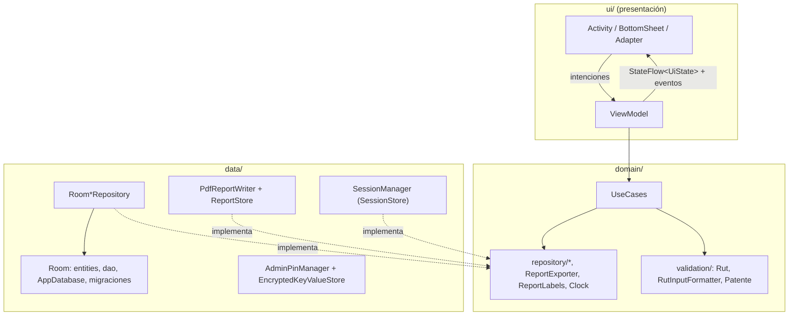
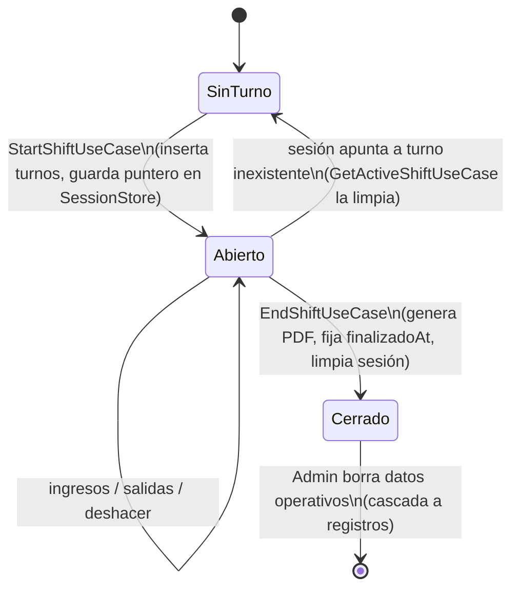
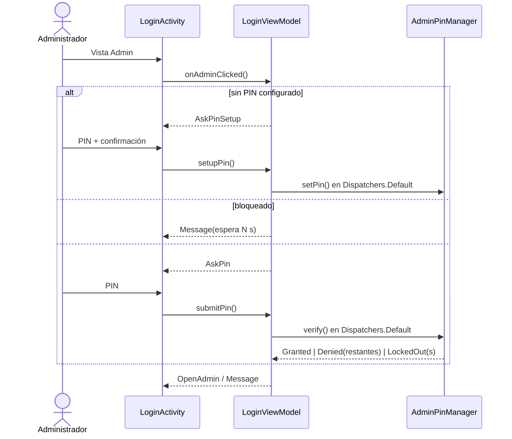

# Arquitectura técnica — Controlate Android

## 1. Visión general

Aplicación de un solo módulo (`:app`) organizada en tres capas por paquete, con la regla de dependencia de Clean Architecture: **presentación → dominio ← datos**. El dominio no conoce Android salvo por las anotaciones de Room en las entidades (ver ADR-005).

El catálogo completo de diagramas (contexto funcional, contratos, ER, estados y secuencias) está en [docs/DIAGRAMS.md](DIAGRAMS.md).

### Responsabilidades

| Capa | Contiene | No contiene |
| :--- | :--- | :--- |
| `ui/` | Renderizado (ViewBinding), mapeo de códigos de dominio a recursos (`ui/common/Labels.kt`), navegación, diálogos. | Reglas de negocio, SQL, I/O de archivos. |
| `ui/*ViewModel` | Estado de pantalla (`StateFlow`), eventos de una sola vez (`EventChannel`), orquestación de casos de uso. | `Context`, recursos o vistas. Los mensajes viajan como `UiMessage(@StringRes)`. |
| `domain/` | Casos de uso, validación, modelos, contratos, formato de tiempo, parser CSV, contenido de reportes. | Implementaciones de persistencia y APIs de Android. |
| `data/` | Room, migraciones, carga semilla, sesión, seguridad del PIN y PDF. | Decisiones de negocio. |

### Grafo de dependencias (Koin)

- `dataModule`: base de datos, DAOs, repositorios (`bind` a su interfaz), `AdminPinManager`, `ReportStore`, `ReportExporter`, `ReportLabels`, `Clock`.
- `domainModule`: casos de uso como `factory` (sin estado).
- `presentationModule`: ViewModels.

`KoinGraphTest` resuelve todos los ViewModels con Robolectric para detectar errores de cableado en CI.

### Estado y eventos

Cada pantalla sigue un flujo unidireccional:

1. La vista llama a una función del ViewModel (`register`, `markExit`, `endShift`…).
2. El ViewModel ejecuta el caso de uso en `viewModelScope` y actualiza `UiState` con `update {}`.
3. Los efectos únicos (navegar, snackbar con **Deshacer**, compartir PDF) se emiten por un `Channel` y se recolectan con `repeatOnLifecycle(STARTED)`, así no se repiten tras una rotación.
4. Los formularios (bottom sheets) consumen un canal propio (`formEvents`), separado del de la Activity, porque un `Channel` entrega cada evento a un solo colector.

---

## 2. Flujos principales

### Ciclo de vida de un turno

### Acceso de administrador

---

## 3. Persistencia

- **Fuente única de verdad:** SQLite (Room). La sesión en `SharedPreferences` guarda solo el **id** del turno abierto; los datos del turno viven en la tabla `turnos`.
- **Tiempo:** `entradaAt`, `salidaAt`, `iniciadoAt` y `finalizadoAt` son epoch millis. `TimeFormat` (java.time) los formatea en la zona del dispositivo. Las estadísticas diarias usan el rango `[00:00, 24:00)` local.
- **Códigos estables:** `tipoPersona` (`PersonaType.name`), `tipo` de turno (`ShiftType.name`) y `controlPoint` (`ControlPoint.id`). Las etiquetas visibles salen de `strings.xml`, salvo el nombre del punto de control, que es un dato editable en `puntos_control`.
- **Integridad:** FK `shiftId → turnos.id` con `ON DELETE CASCADE`; índice único en `personas.patente`; índices en `shiftId`, `entradaAt`, `rut` y `patente`. `turnos.controlPoint` referencia a `puntos_control` sin FK a propósito: un punto nunca se borra y los turnos heredados con ids antiguos siguen siendo legibles.
- **Búsqueda:** `instr(upper(col), upper(:q))` en lugar de `LIKE`, para que `%` y `_` del usuario no sean comodines.
- **Carga semilla:** `DatabaseSeeder` corre una sola vez por arranque y carga el directorio demo solo en instalaciones nuevas.

### Migraciones

| Versión | Cambio |
| :--- | :--- |
| 12 → 17 | Columnas incrementales del bicicletero y tablas del examen (heredadas). |
| 17 → 18 | Crea `turnos` desde los datos repetidos en cada registro. Convierte fecha y hora de texto a epoch millis (si la salida tiene hora menor a la entrada, cuenta como del día siguiente). Normaliza RUT y `tipoPersona`, unifica el formato de fecha del bicicletero, elimina preguntas duplicadas y recupera el turno abierto que versiones anteriores guardaban solo en preferencias (`LegacyActiveShift`). |
| 18 → 19 | Se retira el simulador OS-10: elimina `examen_preguntas` y `examen_resultados`. No toca datos operativos. |
| 19 → 20 | Crea `puntos_control` e inserta los puntos de fábrica (`INSERT OR IGNORE`, parametrizado). Las instalaciones nuevas los reciben en el `onCreate` de Room. |

Cada migración tiene su test (`Migration17To18Test`, `Migration18To19Test`, `Migration19To20Test`): crea una base real de la versión de origen con `MigrationTestHelper`, la migra y valida el esquema contra el JSON exportado en `app/schemas/`.

---

## 4. Architecture Decision Records

### ADR-001 — Offline-first con Room como fuente única de verdad
- **Contexto:** los puntos de control pueden operar sin conectividad o con conexión intermitente.
- **Decisión:** toda operación se persiste localmente; no hay backend.
- **Consecuencias:** latencia mínima y operación garantizada. Requiere disciplina de migraciones (esquema exportado y testeado) y no hay consolidación entre dispositivos.

### ADR-002 — Koin para inyección de dependencias
- **Contexto:** proyecto mediano y un solo módulo, con prioridad en builds rápidos.
- **Decisión:** Koin con módulos por capa.
- **Consecuencias:** sin generación de código. Los errores de cableado se detectan en tiempo de ejecución, mitigado con `KoinGraphTest`.

### ADR-003 — PIN de administrador local sin credenciales por defecto
- **Decisión:** PIN definido en el primer uso, hash PBKDF2-HMAC-SHA256 (100 000 iteraciones y salt de 16 bytes), almacenamiento en `EncryptedSharedPreferences`, bloqueo de 30 s tras 5 fallos y `commit()` síncrono del contador.
- **Consecuencias:** sin secretos en el repositorio. La lógica (`AdminPinManager`) se prueba sin Android gracias a la abstracción `KeyValueStore`.

### ADR-004 — Instantes en epoch millis y turnos como entidad
- **Contexto:** la v17 guardaba `"HH:mm"` y fechas en dos formatos distintos, y repetía guardia, punto y tipo de turno en cada registro. Esto rompía los turnos nocturnos (`MIN("02:00") < "21:00"`) y las estadísticas diarias.
- **Decisión:** tabla `turnos` como raíz de agregación con FK desde los registros y tiempos en epoch millis.
- **Consecuencias:** consultas correctas y reportes coherentes, a cambio de una migración no trivial (cubierta por tests).

### ADR-005 — Entidades Room como modelos de dominio
- **Contexto:** las entidades son `data class` planas; un modelo de dominio paralelo duplicaría cada clase y su mapeo 1:1.
- **Decisión:** el dominio reutiliza las entidades y define **contratos** de repositorio propios (`domain/repository`). Las reglas de negocio no dependen de Room, solo de esas interfaces.
- **Consecuencias:** menos código. Costo: el dominio importa las anotaciones de Room. Si la persistencia cambiara, habría que introducir modelos propios.

### ADR-006 — Estado de UI con StateFlow y eventos por Channel
- **Decisión:** `StateFlow<UiState>` para el estado y `Channel` (`EventChannel`) para efectos únicos. Se elimina LiveData.
- **Consecuencias:** ViewModels testeables con `kotlinx-coroutines-test` y sin eventos repetidos tras rotaciones.

### ADR-007 — Reportes PDF nativos, contenido en el dominio
- **Decisión:** `BuildReportUseCase` produce un `ReportDocument` (columnas, filas y metadatos) y `PdfReportWriter` lo dibuja con `android.graphics.pdf` en `Dispatchers.IO`. Los PDF se guardan en `files/reports` y se comparten vía `FileProvider`.
- **Consecuencias:** sin dependencias pesadas y el contenido del reporte queda testeado. El diseño visual del PDF es simple (tabla paginada).

### ADR-008 — Puntos de control como datos, no como código
- **Contexto:** los puntos de control eran un `enum`; agregar o renombrar uno exigía una nueva versión de la app.
- **Decisión:** tabla `puntos_control` (id, nombre, tipo, orden, activo) con los puntos de fábrica precargados. El id es inmutable y nunca se reutiliza; el nombre es editable; desactivar reemplaza al borrado. Siempre debe quedar al menos un punto activo por tipo.
- **Consecuencias:** el administrador gestiona los puntos sin publicar una versión nueva y el historial permanece intacto. El nombre del punto pasa a ser un dato editable en vez de un texto de `strings.xml`, y las pantallas lo leen del repositorio.
