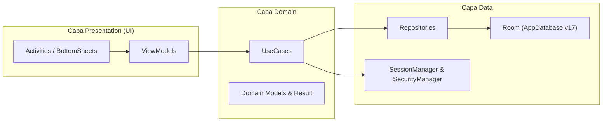

# Arquitectura Técnica — Controlate Android

## 1. Visión General

`controlate-android` implementa una arquitectura en capas (**Presentation / UI -> Domain -> Data**) inspirada en Clean Architecture y el patrón **MVVM**, optimizada para operación **offline-first** en dispositivos Android (`minSdk = 26`, `targetSdk = 36`).

## 2. Capas y Responsabilidades

### Presentation (`porteria/ui/`)
- **Activities y BottomSheets:** Renderizado declarativo con XML + `ViewBinding`. Sin lógica de negocio ni acceso directo a DAOs.
- **ViewModels:** Exponen estado observable (`StateFlow` / `LiveData`) y delegan acciones en casos de uso.

### Domain (`porteria/domain/`)
- **UseCases:** Encapsulan reglas de negocio reutilizables (`ValidateRegistroUseCase`, `SaveRegistroUseCase`, `MarkExitUseCase`, `SearchPersonaUseCase`, `ExportShiftReportUseCase`).
- **Modelos:** `PersonaType`, `ShiftType`, `ShiftInfo` y el wrapper tipado `Result`.

### Data (`porteria/data/`)
- **Room (`AppDatabase` v17):** Fuente única de verdad local con migraciones explícitas (`12->13` hasta `16->17`) y `SeedCallback` para precarga inicial desde `res/raw/`.
- **Seguridad (`SecurityManager` + `PinSecurityHelper`):** Almacenamiento cifrado con `EncryptedSharedPreferences` y derivación de PIN con `PBKDF2WithHmacSHA256`.
- **Sesión (`SessionManager`):** Contexto del turno activo (`guardia`, `shiftId`, `controlPoint`, `turnoTipo`).

---

## 3. Architecture Decision Records (ADRs)

### ADR-001: Estrategia Offline-First con Room y Migraciones Explícitas
- **Contexto:** Las garitas y puntos de control perimetrales sufren cortes frecuentes de red móvil o Wi-Fi.
- **Decisión:** Usar Room (SQLite) como almacenamiento primario obligatorio, con migraciones explícitas por versión y sin dependencia de backend para operar.
- **Consecuencias:** Latencia cercana a cero en búsquedas y registros; requiere mantener disciplina estricta de migraciones al modificar entidades.

### ADR-002: Koin como Contenedor de Inyección de Dependencias
- **Contexto:** Se requiere desacoplar DAOs, repositorios, `SecurityManager`, `SessionManager`, UseCases y ViewModels manteniendo tiempos de compilación rápidos.
- **Decisión:** Utilizar Koin (`AppModule.kt`) frente a Dagger/Hilt.
- **Consecuencias:** Configuración concisa en Kotlin puro y menor sobrecarga de compilación; la resolución de dependencias se valida en tiempo de ejecución o pruebas de grafo.

### ADR-003: Autenticación Administrativa Local sin Credenciales por Defecto
- **Contexto:** Una aplicación distribuida públicamente no debe incluir PINs o contraseñas por defecto en el código fuente.
- **Decisión:** Exigir la configuración del PIN administrativo en el primer acceso, derivar el secreto con `PBKDF2WithHmacSHA256` (100.000 iteraciones + salt aleatorio de 16 bytes), almacenar el hash en `EncryptedSharedPreferences` y aplicar bloqueo temporal de 30 s tras 5 intentos fallidos.
- **Consecuencias:** Elimina exposición de secretos en el repositorio y mitiga ataques de fuerza bruta local.
