# Diagramas del sistema — Controlate Android (v1.1.0)

Vista arquitectónica completa del sistema en formato Mermaid, alineada al código fuente actual (`Room v18`, Clean Architecture + MVVM + Koin).

---

## 1. Contexto funcional y capacidades por actor

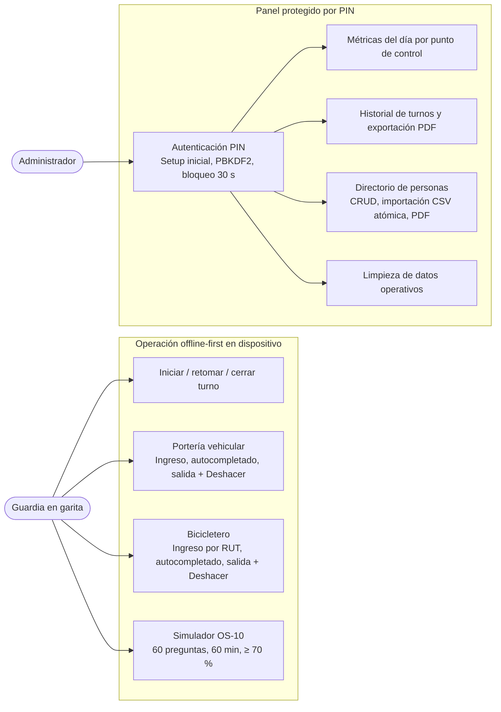

---

## 2. Arquitectura de paquetes y regla de dependencias (DIP)

La regla de dependencia apunta hacia `domain/`: `ui/` orquesta casos de uso y `data/` implementa los puertos definidos en `domain/repository/` y `domain/report/`. El grafo se ensambla en `di/AppModule.kt`.

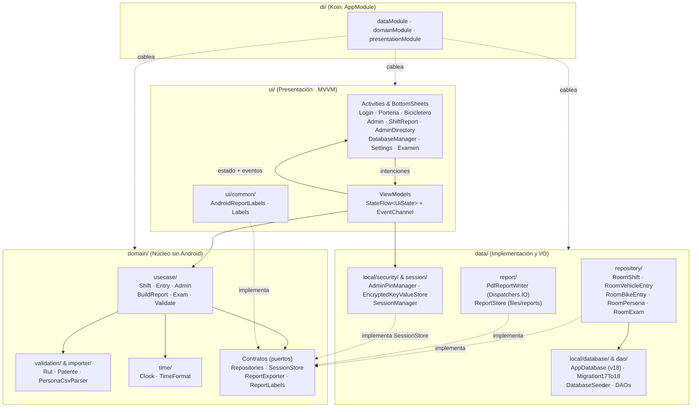

---

## 3. Contratos de dominio e implementaciones (Clases clave)

```mermaid
classDiagram
    class SessionStore {
        <<interface>>
        +activeShiftId() Long?
        +setActiveShift(id: Long)
        +clear()
    }
    class ShiftRepository {
        <<interface>>
        +insert(turno: Turno) Long
        +get(id: Long) Turno?
        +finish(id: Long, at: Long) Boolean
        +observeSummaries() Flow~List~ShiftSummary~~
        +countByPoint(from: Long, to: Long) List~PointCount~
    }
    class VehicleEntryRepository {
        <<interface>>
        +observeByShift(shiftId: Long, query: String) Flow~List~RegistroIngreso~~
        +insert(registro: RegistroIngreso) Long
        +markExit(id: Long, at: Long) Boolean
        +undoExit(id: Long, at: Long) Boolean
    }
    class BikeEntryRepository {
        <<interface>>
        +observeByShift(shiftId: Long, query: String) Flow~List~RegistroBicicleta~~
        +insert(registro: RegistroBicicleta) Long
        +latestByRut(rut: String) RegistroBicicleta?
        +markExit(id: Long, at: Long) Boolean
        +undoExit(id: Long, at: Long) Boolean
    }
    class PersonaRepository {
        <<interface>>
        +search(query: String) Flow~List~Persona~~
        +getByPatente(patente: String) Persona?
        +getByRut(rut: String) Persona?
        +insertIfAbsent(persona: Persona)
        +upsertAll(personas: List~Persona~)
    }
    class ExamRepository {
        <<interface>>
        +randomQuestions(limit: Int) List~ExamenPregunta~
        +saveResult(resultado: ExamenResultado) Long
    }
    class ReportExporter {
        <<interface>>
        +export(document: ReportDocument) File
    }

    SessionStore <|.. SessionManager
    ShiftRepository <|.. RoomShiftRepository
    VehicleEntryRepository <|.. RoomVehicleEntryRepository
    BikeEntryRepository <|.. RoomBikeEntryRepository
    PersonaRepository <|.. RoomPersonaRepository
    ExamRepository <|.. RoomExamRepository
    ReportExporter <|.. PdfReportWriter
```

---

## 4. Modelo de datos (Room v18)

`turnos` es la raíz de agregación. Los instantes se almacenan en **epoch millis** (`iniciadoAt`, `finalizadoAt`, `entradaAt`, `salidaAt`, `realizadoAt`). `personas` y las tablas de examen son independientes de `turnos`.

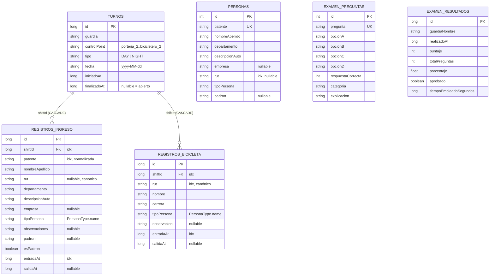

---

## 5. Ciclo de vida del turno y cierre con reporte

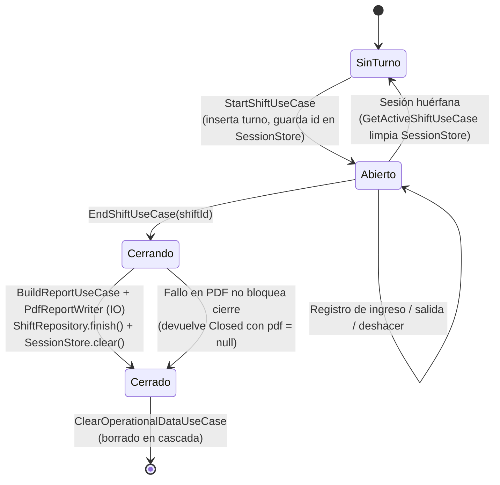

---

## 6. Secuencias críticas

### 6.1 Registro vehicular con autocompletado y alta segura en directorio

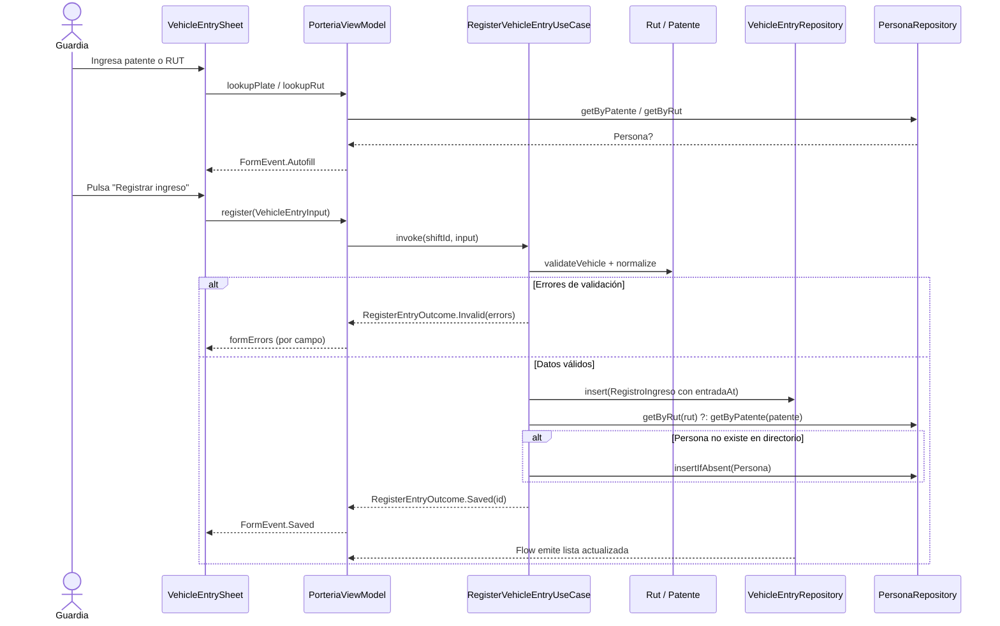

### 6.2 Acceso de administrador y bloqueo por intentos fallidos

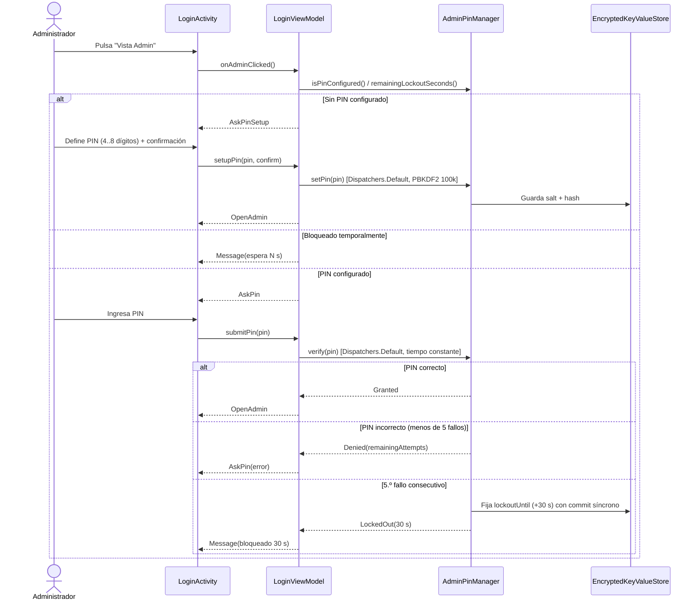

---

## 7. Mapa de navegación entre pantallas

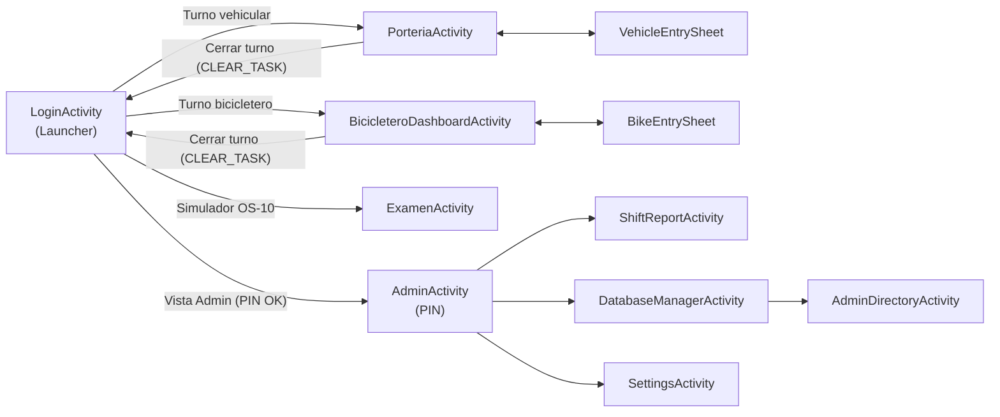

---

## 8. Arranque, migración y carga semilla (`App` → `DatabaseSeeder`)

```mermaid
sequenceDiagram
    participant App as App.onCreate()
    participant Koin as Koin (appModules)
    participant Seed as DatabaseSeeder
    participant DB as AppDatabase (Room v18)

    App->>Koin: startKoin(appModules)
    App->>Seed: launch(Dispatchers.IO) { seedIfNeeded() }
    Seed->>DB: examenDao().countPreguntas()
    Note over DB: Al abrir SQLite por 1.ª vez:<br/>si v17 -> Migration17To18;<br/>si nueva -> onDatabaseCreated()
    alt Instalación nueva y personas == 0
        Seed->>DB: personaDao().upsertAll(res/raw/seed_personas.json)
    end
    alt examen_preguntas == 0
        Seed->>DB: examenDao().insertPreguntas(res/raw/seed_preguntas.json)
    end
```

---

## 9. Pipeline de generación y compartición de reportes PDF

Separa la composición de datos (testeable en JVM) del renderizado Android (`PdfDocument` en `Dispatchers.IO`).

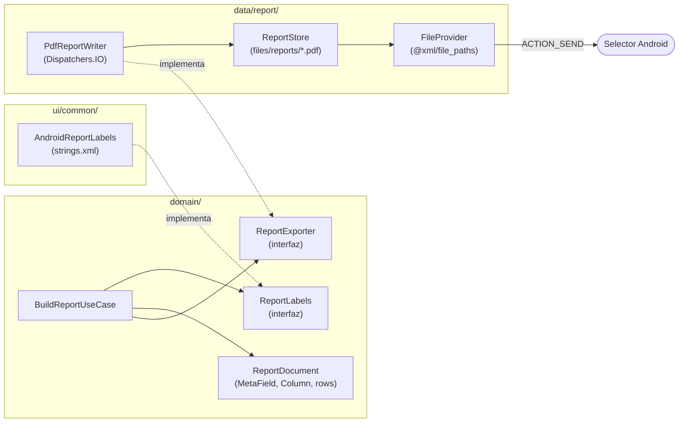

---

## 10. Flujos de integridad operativa

### 10.1 Salida idempotente y Deshacer seguro

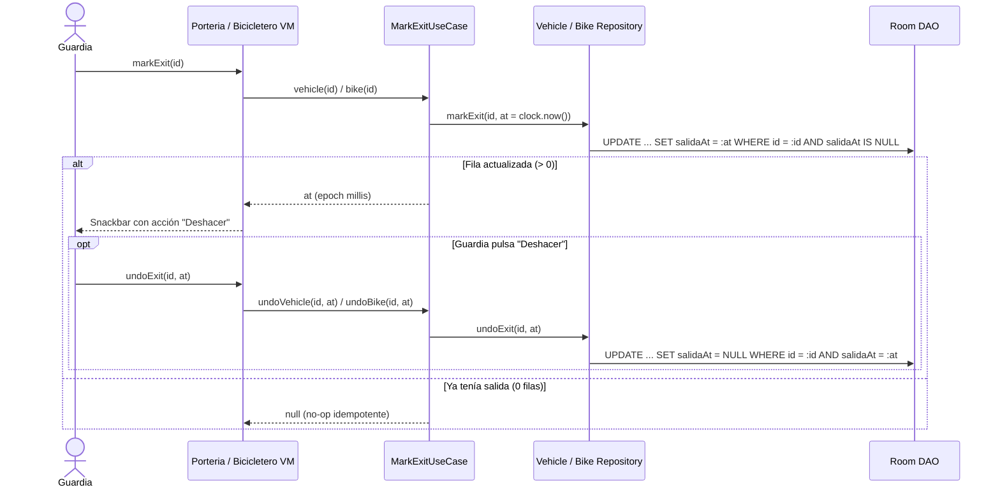

### 10.2 Importación CSV atómica del directorio

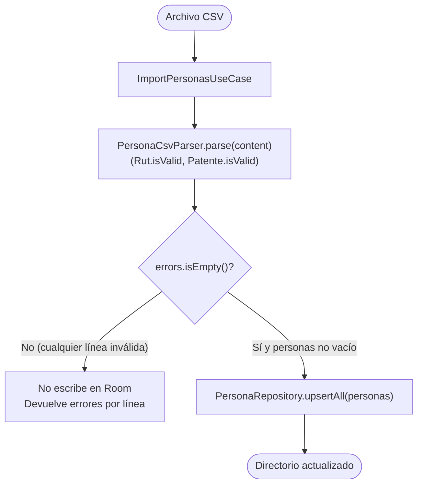
